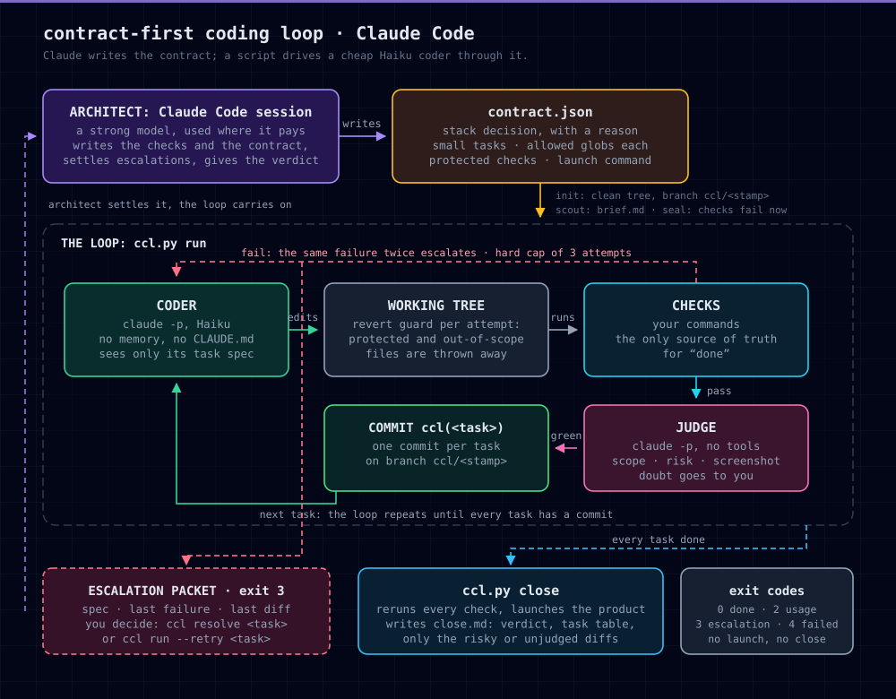

<div align="center">

# claude-contract-loop

**Build software with Claude's judgment at a cheap model's price, on Claude Code.**

[](#requirements) [](#requirements) [](LICENSE) [](skills/claude-contract-loop/SKILL.md)

</div>

---



---

## The idea

Asking a cheap model to "build the feature" fails in a predictable way. It wanders outside the files it should touch, it declares victory without proof, and you spend more reading its output than you saved. Asking the strong model to do everything works, but the bill is high.

The loop splits the work by what each side does well. The architect, the strongest model you have selected in the current session, writes the contract: the stack decision, small tasks, the files each task may touch, and the acceptance checks that prove each task done. A script then runs the loop with `claude -p` on Haiku 5.5 at max effort. Executable checks decide "done", a judge gates what checks cannot see, and every run ends in a verdict.

It runs on your Claude login alone: no API keys and no second model provider.

## When to use

- A coding task that splits into two or more small tasks, each with a command that proves it done.
- Not for one-line fixes, pure exploration, or work that no command can check.

## Roles

| Role | Default | Job | Tools |
|---|---|---|---|
| Architect | the strongest model selected in your current session (`/model`) | writes the contract and the checks, settles escalations, gives the verdict | n/a |
| Scout | `claude -p --model claude-haiku-5-5 --effort max` | reads the repo, writes `brief.md` (asked to keep it to 60 lines) | Read, Glob, Grep |
| Coder | `claude -p --model claude-haiku-5-5 --effort max` | implements one task at a time; sees only its spec | Read, Edit, Write, Glob, Grep, Bash |
| Judge | `claude -p --model claude-haiku-5-5 --effort max` | typed gates: scope, repeated failure, screenshot, risk per file | none (the visual gate adds Read) |
| Checks | your commands | the only source of truth for "done" | n/a |

## How a run goes

1. **`init`** checks the CLI and the login, refuses a dirty tree, cuts branch `ccl/<stamp>`, and creates the state directory outside the repo.
2. **`scout`** has Haiku read the repo and write a one-page brief. The scout is read-only.
3. **Contract.** You write `contract.json` from the example: the stack decision with a reason, the tasks, the `allowed` globs, the `protected` checks, and the real `launch` command.
4. **`seal`** validates the contract and commits the checks.
5. **`run`** implements the tasks in order. After each attempt, out-of-scope and protected changes are reverted, the checks run, and the scope gate judges the diff. A passing task becomes a `ccl(<task>)` commit. A task that fails the same way twice, stays red after three attempts, or gets rejected by the scope gate goes to escalation (exit 3).
6. **`close`** reruns every check together, launches the product for real, and writes `close.md`: the verdict, a task table, and only the diffs judged high-risk or unjudged.
7. **Hand over.** The work sits on `ccl/<stamp>`. Nothing is merged or pushed unless you ask.

## Install

```sh
./install.sh                 # copies the skill to ${CLAUDE_HOME:-~/.claude}/skills/claude-contract-loop
./install.sh --dir <path>    # any other skills root
```

Claude Code loads the installed copy, so after an edit to the repo, run `install.sh` again. Remove it with `rm -rf ~/.claude/skills/claude-contract-loop`.

## Commands

In Claude Code, ask for the contract loop and the skill takes over. To drive it yourself, define a shell function. A variable that holds a command with arguments breaks in zsh.

```sh
ccl() { python3 "$HOME/.claude/skills/claude-contract-loop/scripts/ccl.py" "$@"; }
ccl --repo <repo> init
ccl --repo <repo> scout --goal "..."
# write <state>/contract.json (start from <state>/contract.example.json), then:
ccl --repo <repo> seal
ccl --repo <repo> run
ccl --repo <repo> close
```

| Command | Does |
|---|---|
| `init [--force]` | CLI and login check, clean-tree check, branch `ccl/<stamp>`, state dir outside the repo |
| `scout --goal "..."` | Haiku writes `brief.md` (asked to keep it to 60 lines), read-only |
| `seal` | Validates `contract.json`, commits the acceptance checks |
| `run [--no-judge]` | Implements tasks in order. Exit 3 = escalation packet waiting |
| `resolve <task>` | Accepts your own fix for an escalated task (checks must pass) |
| `run --retry <task>` | Discards the failed attempt and starts the task again |
| `close` | Reruns all checks, launches the product, writes `close.md`. Exit 4 = failed |
| `status` | One line per task, and the spend so far |

Exit codes: `0` done · `2` usage error · `3` escalation waiting for the architect · `4` failed (also: CLI missing or not logged in).

## What is enforced, and what is not

Enforced for every model call:
- the tool list per role (`--tools`, `--allowedTools`), no MCP servers (`--strict-mcp-config`), project and local settings only (`--setting-sources project,local`), and no CLAUDE.md, skills, hooks or plugins from your own setup (`--safe-mode`);
- deny rules (`--disallowedTools`): `.env` files, ssh, aws, gnupg and gh config files, `.netrc`, `curl`, `wget`, `ssh`, `scp`, `nc`, `sudo`, `rm -rf`, `env` and `printenv`, and the git commands that change history or branches (commit, push, stash, checkout, switch, reset, merge, rebase);
- anything not pre-approved is refused, never prompted (`--permission-mode dontAsk`), so a headless run cannot stall on a question;
- refused calls appear in the attempt's feedback and as `refused:` flags in the close report;
- no saved transcript (`--no-session-persistence`), so what a model read does not sit in `~/.claude/projects`;
- an environment allowlist: keys and tokens in your shell are not passed on (see [Environment](#environment));
- the scope and protected-file guard reverts changes after each attempt.

Not enforced:
- Deny rules match command text. They are guardrails, not a sandbox: `python -c ...` can reach what no pattern names. For an untrusted repo, run the loop in a container or a devcontainer.
- Auth is the Claude Code login. The tool never reads an API key or a `.env` file.
- Turn caps use `--max-turns`. Claude Code 2.1.328 accepts it but leaves it out of `claude --help`, so check it again after an upgrade.
- The judge returns probabilities, not reasons. Doubt and unjudged results are yours to settle.

## Configuration

`skills/claude-contract-loop/roles.json` holds the models, tool lists, deny rules, the environment allowlist and the limits. Override it per machine with `~/.config/claude-contract-loop/roles.json` or the `CLAUDE_CONTRACT_LOOP_ROLES` variable. Models are any alias the `claude` CLI accepts (`haiku`, `sonnet`, `opus`) or a full model name. `effort` is passed as `--effort` (`low`, `medium`, `high`, `xhigh` or `max`); remove it to use the CLI's default. Change a model there, not in the prompts.

The override merges one level down (for example `coder.model`), but a list replaces the default list. If you set `deny`, copy the rules you want to keep.

A project whose checks need `curl`, or a variable from your shell, changes this file: remove the rule from `deny`, or add the name to `env_allow`.

## Environment

| Variable | Purpose |
|---|---|
| `CLAUDE_CONTRACT_LOOP_ROLES` | path to a roles override |
| `CLAUDE_CONTRACT_LOOP_STATE` | root for run state (default `$XDG_STATE_HOME/claude-contract-loop`, else `~/.local/state/claude-contract-loop`) |
| `CLAUDE_CONTRACT_LOOP_CLI` | command that starts Claude Code (default `claude`); the tests point it at a fake |

The model processes get a short allowlist: `PATH`, `HOME`, locale and temp variables, `CLAUDE_CONFIG_DIR`, and the names in `env_allow`. Auth comes from the login, so `ANTHROPIC_API_KEY` and `CLAUDE_CODE_OAUTH_TOKEN` in your shell are not passed on. To pass a variable a check needs, such as a proxy setting, add its name to `env_allow`.

## State layout

Everything lives outside the repo, so a failed run never pollutes your worktree:

```
<state root>/<repo>-<hash>/
├── state.json                task states, spend, flags
├── contract.json             your contract (the example is copied here on init)
├── contract.example.json
├── brief.md                  the scout's brief
├── escalations/<task>.md     packet: spec, last failure, last diff
├── refs/<task>/              reference image given to the coder, if any
├── shots/<task>.png          screenshot for the visual gate
├── judge/<task>/             images the visual judge reads
├── log/                      prompts (*.prompt.md), raw CLI output (*.out), check output
└── close.md                  the final report
```

## Requirements

- Claude Code CLI, logged in: `npm install -g @anthropic-ai/claude-code`, then `claude auth login`. Written against Claude Code 2.1.328.
- Python 3.9+ and git. `ccl.py` uses the standard library only.
- Optional, for the visual gate: Chrome or Chromium, used headless for screenshots.

## Tests

```sh
python3 -m unittest discover -s tests -v
```

23 tests, fully offline. A fake `claude` CLI stands in for the models, and the suite drives the real loop end to end: happy path, revert guard, escalation and resolve, scope gate, judge failure, launch and close. CI runs it on Python 3.9 and 3.13.

## Design notes

- **Contract first.** The checks are written before the implementation exists, by the model best placed to judge them. That is what makes a cheap coder safe to use.
- **Isolation.** Every call runs with `--safe-mode`, so the models never see your CLAUDE.md, skills or hooks. The coder works from its spec and the brief.
- **`--bare` is not used.** It skips keychain reads, so a login-based setup would stop working.
- **Non-interactive.** `--permission-mode dontAsk` refuses anything not pre-approved, and `--json-schema` makes the judge answer in a fixed shape.
- **Spend cap per call.** Each role has `max_budget_usd`, passed as `--max-budget-usd`.
- **State outside the repo.** `init` refuses a dirty tree, because an acceptance check written beforehand would count as dirt.
- **Globs use `fnmatch`**, where `*` also crosses `/`. Write `tests/**` for a whole tree.
- **Own runtime names.** Paths and variables carry `claude-contract-loop` and `CLAUDE_CONTRACT_LOOP_*`, so the state of this tool never mixes with another install.
- **Private code** goes to Anthropic through your Claude Code login.

## Notes on Claude Code

- The models run through `claude -p` on Haiku 5.5 (`claude-haiku-5-5`) at max effort. Any model the CLI accepts works in `roles.json`.
- No API keys in this tool. The scout, coder and judge all use the Claude login.
- No mockup generation, because Claude does not generate images. Put your own PNG in a task's `reference`. The coder reads it, and the visual gate compares the screenshot against it.
- The judge is a Claude model that returns self-reported probabilities. That is less calibrated than a dedicated typed judge, so the thresholds in `roles.json` are starting values.
- Spend is recorded per role from the cost Claude Code reports. On a subscription that is an API-equivalent figure.
- Isolation comes from `--safe-mode`, so the models never load your CLAUDE.md, skills or hooks.

## What has been run

- The flags were checked against Claude Code 2.1.328. The CLI parser accepts `--model claude-haiku-5-5` and `--effort max` together with the rest of the call.
- This machine's Claude Code is not logged in, so no model call has run yet. The loop has not been tested against a live model.

## License
MIT. See [LICENSE](LICENSE).
